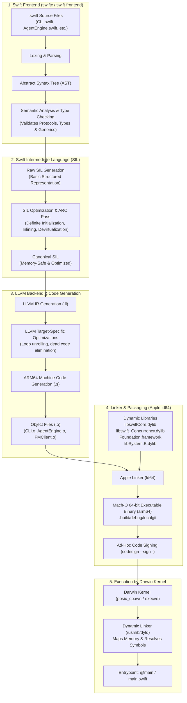
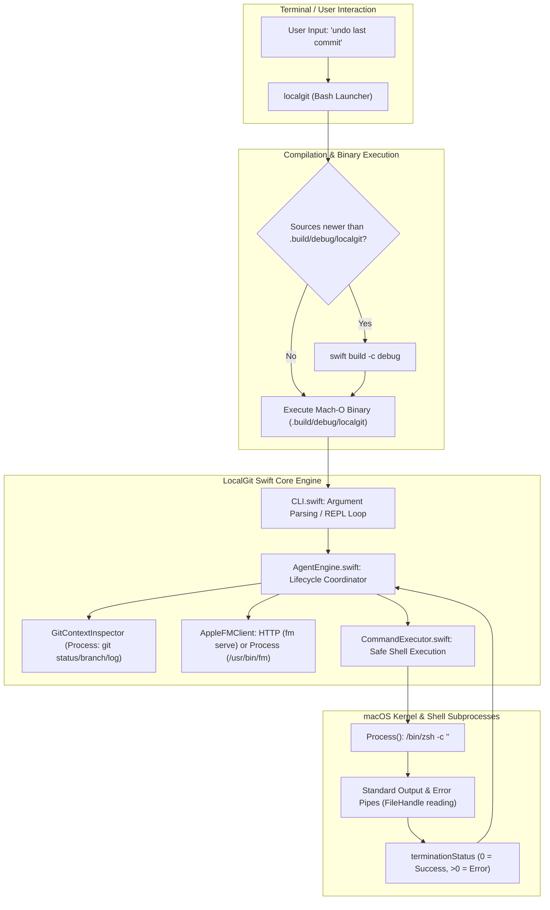

# LocalGit 🤖🍏 (Swift & Xcode)

> **Autonomous Git Agent Harness in Swift, Powered by Local Apple Foundation Models (`fm`)**

`LocalGit` is a native Swift CLI harness and Xcode project that turns natural language intent into executed, verified Git actions. Powered by Apple's on-device Foundation Models (`fm`), it autonomously plans, executes, diagnoses errors, and self-heals without sending any code or prompts to external cloud APIs.

---

## 🌐 The Server-Connected Architecture: How the Server Does All the Work

`LocalGit` is built on a client-server architecture where **the local Apple Foundation Model acts as the intelligent backend server**, while the Swift CLI operates as a lightweight terminal harness.

```mermaid
sequenceDiagram
    autonumber
    actor User as 👤 Developer
    participant Client as 🖥️ LocalGit CLI (Swift Harness)
    participant Server as 🍏 Local FM Server (Apple Foundation Model)
    participant Terminal as 💻 Shell / Git

    User->>Client: "stage all changes and commit with feat: login"
    Note over Client: In Yellow: User Input
    Client->>Client: Inspect Git state (branch, status, logs)
    
    rect rgb(30, 20, 40)
        Note over Client,Server: Step 1: Action Planning (Server-Side)
        Client->>Server: Task + Git Context (+ Session History if enabled)
        Server-->>Client: Plan: { thought, command, explanation }
    end
    
    Note over Client: In Magenta: Model Thinking<br/>In Cyan: Executing Command
    Client->>Terminal: Execute `git add . && git commit -m "feat: login"`
    
    alt Command Succeeded
        Terminal-->>Client: Raw output (e.g. `[main abc1234] feat: login...`)
        rect rgb(20, 35, 25)
            Note over Client,Server: Step 2: Output Synthesis (Server-Side)
            Client->>Server: Task + Executed Command + Raw Terminal Output
            Server-->>Client: Synthesized user-friendly output
        end
        Note over Client: In Green: Synthesized Output
        Client->>User: "Your changes were staged and committed with 'feat: login'!"
    else Command Encountered an Error
        Terminal-->>Client: Exit code != 0, stderr (e.g. conflict, detached HEAD)
        Note over Client: In Red: Terminal Error Output
        rect rgb(40, 20, 20)
            Note over Client,Server: Self-Healing Error Recovery (Server-Side)
            Client->>Server: Task + Failed Command + Error Output + State
            Server-->>Client: Diagnostic Thought + Corrected Command
        end
        Note over Client: In Magenta: Diagnosis Thought<br/>In Cyan: Executing Fix
        Client->>Terminal: Execute Corrected Command
        Terminal-->>Client: Success Output
        Client->>Server: Synthesize final output
        Server-->>Client: User-friendly resolution summary
        Note over Client: In Green: Synthesized Output
        Client->>User: "Conflict resolved and commit finalized successfully."
    end
```



### Why the Server-Connected Model?
- **Cognitive Offloading**: The CLI contains zero hardcoded Git syntax rules. 100% of decision making, diagnosis, and command generation happens on the Foundation Model server.
- **Dual Server Modes**:
  1. **Persistent Server (`fm serve`)**: Run `fm serve --port 1976`. The server keeps the model resident in Apple Neural Engine / Unified Memory, providing ultra-low latency OpenAI-compatible completions at `http://127.0.0.1:1976/v1/chat/completions`.
  2. **Direct CLI Daemon**: If the background server is offline, `LocalGit` automatically falls back to `/usr/bin/fm respond`, requiring no manual server configuration.
- **Two-Step Execution Workflow**:
  - **Step 1**: The server plans the exact Git command sequence.
  - **Step 2**: The server synthesizes the raw terminal output into a friendly, clear summary to present to the user.

---

## ⚙️ Compilation Deep Dive: How Swift Source Becomes a Local Binary

This section explains the exact step-by-step compiler pipeline that transforms plain `.swift` text files into an Apple Silicon native Mach-O executable binary.



### The 5 Phases of the Compilation Pipeline

#### Phase 1: Lexing, Parsing, and Type Checking
1. **Lexing**: The Swift compiler breaks characters in `CLI.swift`, `AgentEngine.swift`, etc. into tokens (`func`, `class`, identifiers, operators).
2. **Parsing**: Tokens are formed into an **Abstract Syntax Tree (AST)**, verifying that grammar and syntax are valid.
3. **Semantic Analysis & Type Checking**: The compiler resolves types, checks protocol conformance (`FMClientProtocol`), infers return types, and validates access control (`public`, `private(set)`).

#### Phase 2: Swift Intermediate Language (SIL)
Unlike C or C++, Swift introduces a domain-specific intermediate stage between the AST and LLVM called **SIL**:
1. **Raw SIL (`swiftc -emit-silgen`)**: Represents the program in a basic control-flow graph.
2. **Definite Initialization**: Ensures all properties and variables are initialized before use.
3. **Automatic Reference Counting (ARC) Optimization**: The SIL optimizer analyzes object lifetimes and eliminates redundant `swift_retain` / `swift_release` operations.
4. **Devirtualization**: Replaces dynamic method dispatch with direct static calls where possible.

#### Phase 3: LLVM IR & Target Code Generation
1. **LLVM IR Generation**: The Canonical SIL is translated into **LLVM Intermediate Representation** (`.ll`).
2. **Apple Silicon Optimizations**: The LLVM backend applies hardware-specific optimizations targeting the Apple M-series chips (AArch64 instruction set, hardware registers `x0`–`x30`, NEON vectorization).
3. **Object File Output**: Generates relocatable machine code object files (`.o`), such as `AgentEngine.o`, `FMClient.o`, and `CLI.o`.

#### Phase 4: Linking & Mach-O Binary Assembly (`ld64`)
The Apple linker (`ld64`) resolves external symbols and combines the individual object files into a single **Mach-O 64-bit executable binary**:
- Sets the entry point to `_main` in `main.swift`.
- Embeds load commands (`LC_LOAD_DYLINKER`, `LC_LOAD_DYLIB`) instructing macOS to load dynamic runtimes at launch:
  ```
  $ otool -L .build/debug/localgit
  /System/Library/Frameworks/Foundation.framework/Versions/C/Foundation
  /usr/lib/libSystem.B.dylib
  /usr/lib/swift/libswiftCore.dylib
  /usr/lib/swift/libswift_Concurrency.dylib
  ```
- **Code Signing**: macOS on Apple Silicon requires every executable to be signed before execution. SwiftPM automatically applies an ad-hoc signature (`codesign --sign -`) satisfying the Darwin kernel execution policy.

#### Phase 5: Kernel Execution (`dyld`)
When `./localgit` is invoked from terminal or a Bash script:
1. The kernel invokes `posix_spawn()` / `execve()`.
2. The macOS dynamic linker (`/usr/lib/dyld`) maps the Mach-O segments (`__TEXT` code, `__DATA` variables) into virtual memory.
3. `dyld` binds runtime symbols (`libswift_Concurrency.dylib` for `async`/`await`) and jumps to the binary's entrypoint.

---

## 🔬 Under the Hood: How Swift Code Executes Terminal Commands

This section explains the exact engineering mechanisms that bridge the high-level Swift codebase down to native terminal commands and process management.



### How Swift Executes Terminal Commands (`Foundation.Process`)
In `Sources/LocalGitCore/Executor.swift`, Swift does not use slow or unsafe C `system()` calls. Instead, it uses **`Foundation.Process`** and Unix anonymous pipes:

```swift
public static func execute(command: String, cwd: String? = nil) -> ExecutionResult {
    // 1. Instantiate the Process object
    let process = Process()
    
    // 2. Set the executable binary to the user shell
    process.executableURL = URL(fileURLWithPath: "/bin/zsh")
    process.arguments = ["-c", command]

    // 3. Set the current working directory to the target git repo
    if let cwd = cwd {
        process.currentDirectoryURL = URL(fileURLWithPath: cwd)
    }

    // 4. Attach anonymous pipes for standard output and error
    let outPipe = Pipe()
    let errPipe = Pipe()
    process.standardOutput = outPipe
    process.standardError = errPipe

    // 5. Spawn the subprocess and wait for completion
    try process.run()
    process.waitUntilExit()

    // 6. Read stream data from file handles into Swift strings
    let outData = outPipe.fileHandleForReading.readDataToEndOfFile()
    let errData = errPipe.fileHandleForReading.readDataToEndOfFile()
    let stdout = String(data: outData, encoding: .utf8) ?? ""
    let stderr = String(data: errData, encoding: .utf8) ?? ""

    // 7. Check kernel exit status
    return ExecutionResult(
        command: command,
        exitCode: process.terminationStatus,
        stdout: stdout,
        stderr: stderr,
        combinedOutput: stdout + stderr
    )
}
```

### How Swift Communicates with the Apple Foundation Model
The client communicates with Apple Foundation Models using two distinct pathways in `Sources/LocalGitCore/FMClient.swift`:

#### Pathway A: HTTP Client to `fm serve` (`URLSession`)
When the server is active, Swift sends asynchronous HTTP POST requests to `http://127.0.0.1:1976/v1/chat/completions`:
```swift
var request = URLRequest(url: URL(string: "http://127.0.0.1:1976/v1/chat/completions")!)
request.httpMethod = "POST"
request.addValue("application/json", forHTTPHeaderField: "Content-Type")

let body: [String: Any] = [
    "model": "system",
    "stream": false,
    "messages": [
        ["role": "system", "content": systemPrompt],
        ["role": "user", "content": userPrompt]
    ]
]
request.httpBody = try JSONSerialization.data(withJSONObject: body)
```

#### Pathway B: Inter-Process Communication (IPC via `/usr/bin/fm respond`)
If the HTTP server is not running, Swift spawns `/usr/bin/fm` with strict JSON schema constraints:
```swift
let process = Process()
process.executableURL = URL(fileURLWithPath: "/usr/bin/fm")
process.arguments = [
    "respond",
    "--no-stream",
    "--schema", schemaFilePath,
    "-i", systemInstructions,
    prompt
]
```
The output is captured through `Pipe` and decoded with `JSONDecoder` into a strongly-typed `GitPlan(thought: String, command: String, explanation: String)`.

### How the Bash Launcher (`localgit`) Integrates with the System
The wrapper script in `localgit` enables system-wide accessibility:
1. **Resolves Real Path**: Uses `readlink` to resolve symlinks if invoked from `~/.local/bin/localgit`.
2. **Auto-Compiles on Code Edits**: Runs `find Sources -newer .build/debug/localgit`. If any Swift source file was modified, it recompiles with `swift build` before running.
3. **Preserves Environment & Context**: Uses `exec "$BIN" "$@"` so process IDs, working directories (`$PWD`), and terminal pipes are passed directly to the Swift binary.

---

## 🎨 Visual Color Hierarchy

`LocalGit` strictly formats every stage in dedicated ANSI colors:
- 👤 **User Task** (`Bright Yellow`): The user's goal or prompt.
- 🧠 **Model Thinking** (`Bright Magenta`): The model's reasoning and diagnosis before executing.
- ⚡ **Command Execution** (`Cyan`): The shell command being executed.
- ✖ **Terminal Error** (`Bright Red`): Raw error output when a command fails.
- 💬 **Synthesized Output** (`Bright Green`): The clean, final output synthesized by the model.

---

## 🧹 Session History & Clean State Management

- **Default Mode (Clean Slate)**: Local models perform best without context pollution. Once a task completes, **task history is automatically cleared** (`clearHistory()`).
- **Persistent History (`-H` / `--with-history`)**: When launched with `-H`, prior completed tasks and executed commands in the session are preserved and sent to the server for multi-task continuity.

---

## 🚀 Running & Global Installation

### 1. From Any Directory in Bash
`localgit` is installed in your `$PATH` (`~/.local/bin/localgit`):
```bash
# Works in any directory or bash script:
localgit "create branch feature-x and switch to it"

# Interactive REPL:
localgit
```

### 2. Auto-Build on Source Changes
The wrapper script in `localgit` automatically detects if any files in `Sources/` have changed and recompiles with `swift build` before running, ensuring you are always running the latest version.

### 3. Open in Xcode
```bash
open LocalGit.xcodeproj
```
Select the `localgit` scheme and press **Cmd + R** to run or debug.

### 4. Optional: Start Persistent Server for Max Speed
```bash
fm serve --port 1976
```
`LocalGit` will automatically detect the server and route completions over local HTTP for near-instant responses.

---

## 🧪 Testing

Run the test suite covering execution, context extraction, schema parsing, and self-healing recovery:
```bash
swift test
```

---

## 📂 Project Structure

```
localgit/
├── LocalGit.xcodeproj        # Native Xcode project
├── project.yml               # XcodeGen specification
├── Package.swift             # Swift Package Manager manifest
├── localgit                  # Global bash launcher script (auto-recompiles)
├── README.md                 # Documentation and architecture
├── .gitignore                # Git ignore rules
├── Tests/
│   └── LocalGitTests/
│       └── LocalGitTests.swift # XCTest unit tests
└── Sources/
    ├── LocalGitCore/
    │   ├── AgentEngine.swift # Autonomous agent loop & error recovery
    │   ├── FMClient.swift    # Dual-mode Apple FM Client (HTTP Server + CLI)
    │   ├── GitContext.swift  # Repository state inspector
    │   ├── Executor.swift    # Safe command executor
    │   └── UI.swift          # Visual color formatting
    └── LocalGitCLI/
        ├── CLI.swift         # REPL & argument parser
        └── main.swift        # Executable entrypoint
```
