# LocalGit 🤖🍏 (Swift & Xcode)

> **Autonomous Git Agent Harness in Swift, Powered by Local Apple Foundation Models (`fm`)**

`LocalGit` is a native Swift CLI harness and Xcode project that turns natural language intent into executed, verified Git actions. Powered by Apple's on-device Foundation Models (`fm`), it autonomously plans, executes, diagnoses errors, and self-heals without sending any code or prompts to external cloud APIs.

---

## 🌐 The Server-Connected Architecture: How the Server Does All the Work

`LocalGit` is built on a client-server architecture where **the local Apple Foundation Model acts as the intelligent backend server**, while the Swift CLI operates as a lightweight terminal harness.

```mermaid
sequenceDiagram
    autonumber
    actor User as 👤 Developer
    participant Client as 🖥️ LocalGit CLI (Swift Harness)
    participant Server as 🍏 Local FM Server (Apple Foundation Model)
    participant Terminal as 💻 Shell / Git

    User->>Client: "stage all changes and commit with feat: login"
    Note over Client: In Yellow: User Input
    Client->>Client: Inspect Git state (branch, status, logs)
    
    rect rgb(30, 20, 40)
        Note over Client,Server: Step 1: Action Planning (Server-Side)
        Client->>Server: Task + Git Context (+ Session History if enabled)
        Server-->>Client: Plan: { thought, command, explanation }
    end
    
    Note over Client: In Magenta: Model Thinking<br/>In Cyan: Executing Command
    Client->>Terminal: Execute `git add . && git commit -m "feat: login"`
    
    alt Command Succeeded
        Terminal-->>Client: Raw output (e.g. `[main abc1234] feat: login...`)
        rect rgb(20, 35, 25)
            Note over Client,Server: Step 2: Output Synthesis (Server-Side)
            Client->>Server: Task + Executed Command + Raw Terminal Output
            Server-->>Client: Synthesized user-friendly output
        end
        Note over Client: In Green: Synthesized Output
        Client->>User: "Your changes were staged and committed with 'feat: login'!"
    else Command Encountered an Error
        Terminal-->>Client: Exit code != 0, stderr (e.g. conflict, detached HEAD)
        Note over Client: In Red: Terminal Error Output
        rect rgb(40, 20, 20)
            Note over Client,Server: Self-Healing Error Recovery (Server-Side)
            Client->>Server: Task + Failed Command + Error Output + State
            Server-->>Client: Diagnostic Thought + Corrected Command
        end
        Note over Client: In Magenta: Diagnosis Thought<br/>In Cyan: Executing Fix
        Client->>Terminal: Execute Corrected Command
        Terminal-->>Client: Success Output
        Client->>Server: Synthesize final output
        Server-->>Client: User-friendly resolution summary
        Note over Client: In Green: Synthesized Output
        Client->>User: "Conflict resolved and commit finalized successfully."
    end
```



### Why the Server Connected Model?
- **Cognitive Offloading**: The CLI contains zero hardcoded Git syntax rules. 100% of decision making, diagnosis, and command generation happens on the Foundation Model server.
- **Dual Server Modes**:
  1. **Persistent Server (`fm serve`)**: Run `fm serve --port 1976`. The server keeps the model resident in Apple Neural Engine / Unified Memory, providing ultra-low latency OpenAI-compatible completions at `http://127.0.0.1:1976/v1/chat/completions`.
  2. **Direct CLI Daemon**: If the background server is offline, `LocalGit` automatically falls back to `/usr/bin/fm respond`, requiring no manual server configuration.
- **Two-Step Execution Workflow**:
  - **Step 1**: The server plans the exact Git command sequence.
  - **Step 2**: The server synthesizes the raw terminal output into a friendly, clear summary to present to the user.

---

## 🎨 Visual Color Hierarchy

`LocalGit` strictly formats every stage in dedicated ANSI colors:
- 👤 **User Task** (`Bright Yellow`): The user's goal or prompt.
- 🧠 **Model Thinking** (`Bright Magenta`): The model's reasoning and diagnosis before executing.
- ⚡ **Command Execution** (`Cyan`): The shell command being executed.
- ✖ **Terminal Error** (`Bright Red`): Raw error output when a command fails.
- 💬 **Synthesized Output** (`Bright Green`): The clean, final output synthesized by the model.

---

## 🧹 Session History & Clean State Management

- **Default Mode (Clean Slate)**: Local models perform best without context pollution. Once a task completes, **task history is automatically cleared** (`clearHistory()`).
- **Persistent History (`-H` / `--with-history`)**: When launched with `-H`, prior completed tasks and executed commands in the session are preserved and sent to the server for multi-task continuity.

---

## 🚀 Running & Global Installation

### 1. From Any Directory in Bash
`localgit` is installed in your `$PATH` (`~/.local/bin/localgit`):
```bash
# Works in any directory or bash script:
localgit "create branch feature-x and switch to it"

# Interactive REPL:
localgit
```

### 2. Auto-Build on Source Changes
The wrapper script in `localgit` automatically detects if any files in `Sources/` have changed and recompiles with `swift build` before running, ensuring you are always running the latest version.

### 3. Open in Xcode
```bash
open LocalGit.xcodeproj
```
Select the `localgit` scheme and press **Cmd + R** to run or debug.

### 4. Optional: Start Persistent Server for Max Speed
```bash
fm serve --port 1976
```
`LocalGit` will automatically detect the server and route completions over local HTTP for near-instant responses.

---

## 🧪 Testing

Run the test suite covering execution, context extraction, schema parsing, and self-healing recovery:
```bash
swift test
```

---

## 📂 Project Structure

```
localgit/
├── LocalGit.xcodeproj        # Native Xcode project
├── project.yml               # XcodeGen specification
├── Package.swift             # Swift Package Manager manifest
├── localgit                  # Global bash launcher script (auto-recompiles)
├── README.md                 # Documentation and architecture
├── .gitignore                # Git ignore rules
├── Tests/
│   └── LocalGitTests/
│       └── LocalGitTests.swift # XCTest unit tests
└── Sources/
    ├── LocalGitCore/
    │   ├── AgentEngine.swift # Autonomous agent loop & error recovery
    │   ├── FMClient.swift    # Dual-mode Apple FM Client (HTTP Server + CLI)
    │   ├── GitContext.swift  # Repository state inspector
    │   ├── Executor.swift    # Safe command executor
    │   └── UI.swift          # Visual color formatting
    └── LocalGitCLI/
        ├── CLI.swift         # REPL & argument parser
        └── main.swift        # Executable entrypoint
```
