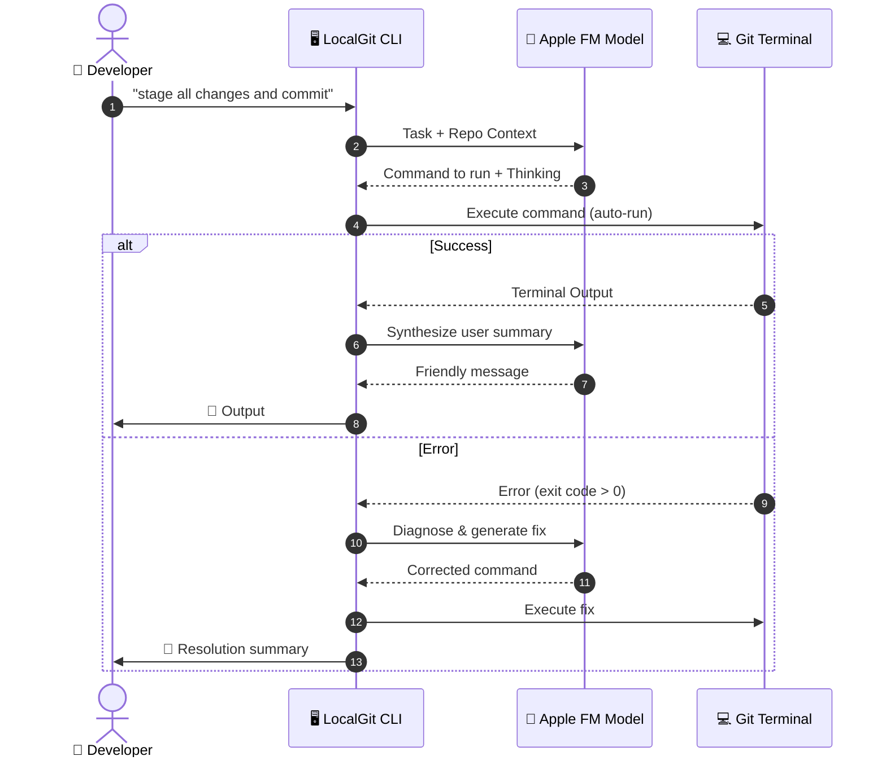

# LocalGit 🤖🍏

> Autonomous Git agent in Swift, powered by local Apple Foundation Models (`fm`).

`LocalGit` translates natural language into executed and verified Git commands using on-device Apple Intelligence. It runs commands autonomously without permission by default, captures errors to self-heal, and synthesizes clean output messages.

---

## ⚡ How It Works



---

## 🌟 Key Features

- **100% Local & Private**: Runs on-device via Apple Foundation Models (`/usr/bin/fm` or `fm serve`). No cloud API keys required.
- **Autonomous Execution**: Runs commands immediately without prompting for confirmation.
- **Two-Step Synthesis**: Terminal outputs are fed back into the local model to produce clean, readable user explanations.
- **Self-Healing**: Automatically diagnoses Git errors and executes fixes.
- **Color-Coded Output**:
  - 👤 **Yellow**: User input
  - 🧠 **Magenta**: Model thinking & reasoning
  - ⚡ **Cyan**: Executed command
  - ✖ **Red**: Terminal error output
  - 💬 **Green**: Final synthesized output
- **Clean Slate by Default**: Task history is cleared upon completion to prevent context pollution (use `-H` to retain).

---

## 🚀 Quick Start

### Installation
Clone and install to your `$PATH` (`~/.local/bin`):
```bash
git clone https://github.com/abhi266raj/localgit.git
cd localgit
./install.sh
```

### Usage
```bash
# Run any git task from anywhere
localgit "create branch feature-login and switch to it"
localgit "undo last commit and keep changes staged"

# Interactive REPL session
localgit

# Retain history across tasks
localgit -H
```

### Options
| Flag | Description |
|---|---|
| `-a`, `--ask` | Ask for confirmation before executing commands |
| `-H`, `--with-history` | Retain session task history across multiple tasks |
| `-r`, `--max-retries <n>` | Max self-healing retry attempts (default: 3) |
| `-v`, `--verbose` | Print detailed reasoning and context |
| `-C`, `--cwd <path>` | Target Git repository directory |
| `-h`, `--help` | Show help information |

---

## 🛠️ Development

- **Open in Xcode**: `open LocalGit.xcodeproj`
- **Run Tests**: `swift test` or `make test`
- **Build Release**: `swift build -c release`
- **Optional Speedup**: Run `fm serve --port 1976` in the background for instant HTTP completions.
