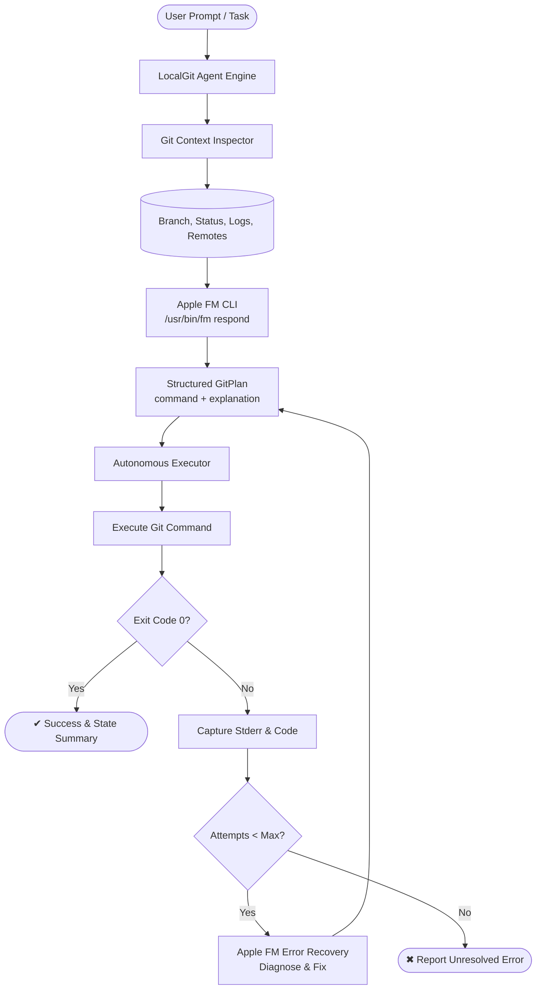

# LocalGit 🤖🍏

> **Autonomous Git Agent Harness Powered by On-Device Apple Foundation Models (`fm`)**

`LocalGit` is a local harness that turns your natural language intent into executed, verified Git actions. Powered by Apple's on-device Foundation Models (`fm` CLI), it autonomously plans, executes, diagnoses errors, and self-heals without sending your code or prompts to any external cloud API.

---

## 🌟 Key Features

- **100% Local & Private**: Uses macOS's built-in Apple Foundation Models (`/usr/bin/fm`). Zero cloud dependency, zero API keys required, zero data leaves your Mac.
- **Autonomous Execution**: By default, runs commands immediately without prompting for permission, optimizing developer workflow speed.
- **Self-Healing Verification Loop**: If a Git command fails (e.g. branch already exists, merge conflict, untracked changes, detached HEAD), `LocalGit` captures the exit code and stderr, feeds it back to the Apple Foundation Model for diagnosis, and automatically executes the fix.
- **Context-Aware**: Inspects branch names, recent commit logs, working tree status (`git status --short`), and remotes before prompting the model.
- **Interactive REPL & CLI**: Run as an interactive shell (`localgit`) or as a one-liner (`localgit "undo last commit but keep changes"`).
- **Safety Safeguards**: Sanitizes commands to protect against non-git destructive shell commands.

---

## 🏗️ Architecture



---

## 📋 Prerequisites

1. **macOS 15+** with Apple Intelligence enabled.
2. Apple Foundation Models CLI available at `/usr/bin/fm` (check with `fm available`).
3. Python 3.9+
4. Git

---

## 🚀 Quick Start

### 1. Run Directly
You can run the executable directly from this folder:
```bash
# Interactive REPL session
./localgit

# Single-shot command
./localgit "undo last commit and keep changes staged"
```

### 2. Install as a System Command
To use `localgit` from anywhere across any terminal or directory:

**Option A: Editable pip install**
```bash
pip install -e .
```

**Option B: Symlink to user PATH**
```bash
mkdir -p ~/.local/bin
ln -s "$(pwd)/localgit" ~/.local/bin/localgit
# Ensure ~/.local/bin is in your $PATH
```

---

## 💻 Usage Examples

### 1. Interactive Agent Mode
Start `localgit` without arguments:
```
$ localgit

  _                     _  ____ _ _   
 | |    ___   ___ __ _| |/ ___(_) |_ 
 | |   / _ \ / __/ _` | | |  _| | __|
 | |__| (_) | (_| (_| | | |_| | | |_ 
 |_____\___/ \___\__,_|_|\____|_|\__|
 Local Apple Foundation Model Git Agent (powered by `fm`)

localgit (main) > stage all files and commit with feat: initial setup
ℹ Consulting Apple Foundation Model for task: 'stage all files and commit with feat: initial setup'...
🤖 Proposed Command: git add . && git commit -m "feat: initial setup"
   Explanation: Stages all modified and untracked files and commits them with the specified message.
⚡ Executing (auto-run): git add . && git commit -m "feat: initial setup"
✔ Command executed successfully!
↳ Current state: [branch: main] clean

localgit (main) > exit
```

### 2. Single-Shot Mode
```bash
# Create and switch to a branch
localgit "create branch feature/auth and switch to it"

# Stash current uncommitted changes
localgit "stash untracked and modified files with label wip"

# View recent commit history
localgit "show last 3 commits in one line each"
```

### 3. CLI Flags & Options
| Flag | Description | Default |
| --- | --- | --- |
| `-a`, `--ask` | Prompt user for `[Y/n]` confirmation before executing commands | `False` (Autonomous) |
| `-r`, `--max-retries` | Max self-healing recovery attempts upon error | `3` |
| `-v`, `--verbose` | Print detailed model reasoning, context, and raw outputs | `False` |
| `-C`, `--cwd` | Target directory of the repository to act upon | Current directory |

---

## 🔄 Self-Healing Error Recovery Example

When a command fails, `LocalGit` automatically engages the on-device Apple FM model:

```
ℹ Consulting Apple Foundation Model for task: 'switch to branch feature-x'...
🤖 Proposed Command: git checkout feature-x
⚡ Executing (auto-run): git checkout feature-x
✖ Command exited with code 1
error: pathspec 'feature-x' did not match any file(s) known to git

🔄 Error encountered. Asking Apple FM model to diagnose & fix (attempt 1/3)...
🤖 Proposed Command: git checkout -b feature-x
   Explanation: The branch did not exist locally, so create it and switch to it.
⚡ Executing (auto-run): git checkout -b feature-x
Switched to a new branch 'feature-x'
✔ Recovery successful on attempt 1! Goal achieved.
```

---

## 🧪 Testing

Run the test suite:
```bash
python3 -m unittest discover tests
```

---

## 📂 Project Structure

```
harness/
├── localgit                 # Standalone executable entrypoint
├── pyproject.toml           # Packaging and CLI script entrypoint
├── README.md                # Documentation and architecture
├── .gitignore               # Git ignore rules
├── tests/
│   └── test_harness.py      # Unit tests for context, executor, client, and engine
└── localgit_harness/
    ├── __init__.py          # Package metadata
    ├── cli.py               # Interactive REPL and argument parser
    ├── engine.py            # Agent harness loop & recovery coordinator
    ├── executor.py          # Shell command executor and safety filter
    ├── fm_client.py         # Apple FM CLI interface with structured schemas
    ├── git_context.py       # Git repository state inspector
    └── ui.py                # ANSI terminal styling and status indicators
```
